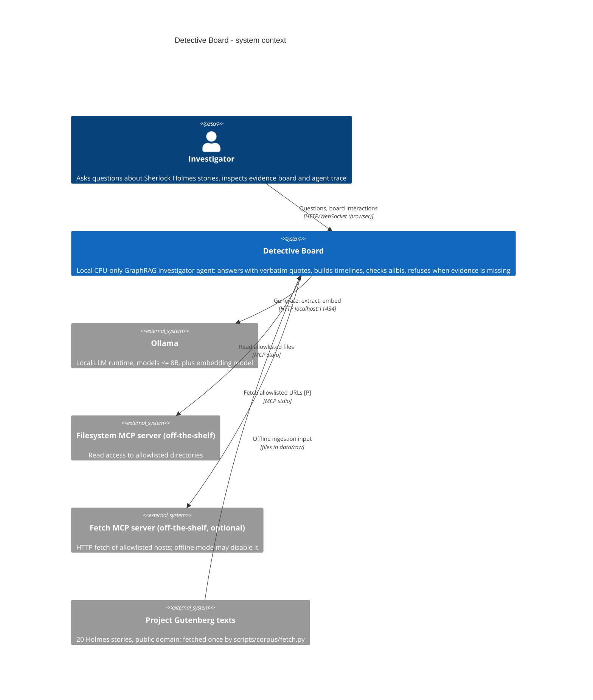
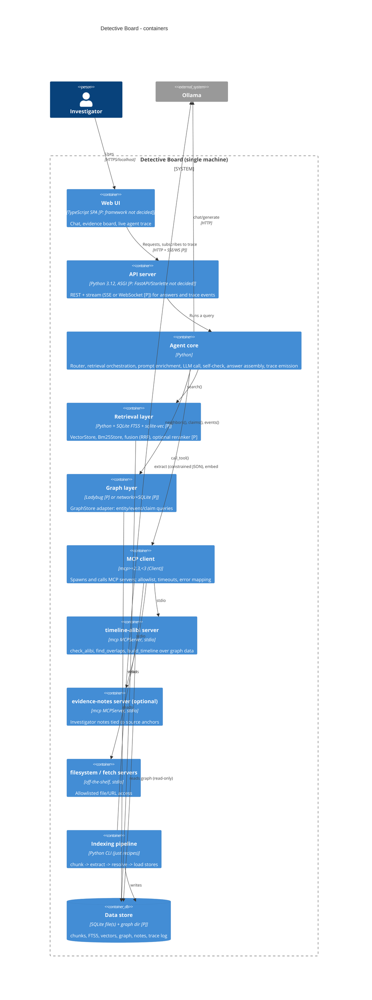
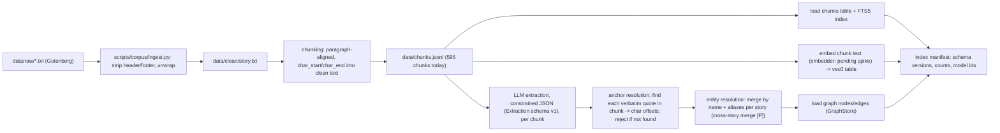
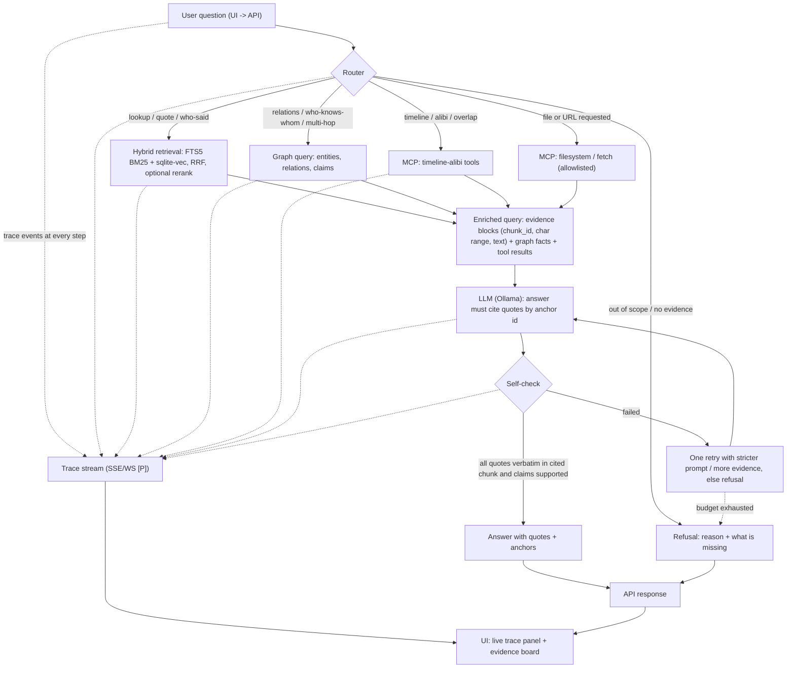

# Architecture (C4 L1-L2 and flows)

Status: DRAFT, Phase 0. Written from `docs/spike/db-research.md` (desk research, nothing installed or run), `src/detective_board/extract/schema.py` and `data/LICENSES.md`. `docs/PRD.md` does not exist yet; nothing here is checked against it.

Provisional marks: **[P]** = provisional, depends on a pending measurement or ADR with status Proposed. **[U]** = unverified (not confirmed in a fetched source). Model choice and embedding choice are deliberately left open (spike numbers pending); they appear below as "LLM (Ollama)" and "embedder" placeholders only.

## L1: System context

Notes: the runtime is offline after corpus fetch. The corpus is data, never instructions (prompt-injection boundary: chunk text is always placed inside delimited evidence blocks and never in the system prompt).

## L2: Containers

Container notes:
- Single process is acceptable for Phase 1: API, agent core, retrieval and graph can run in one Python process; MCP servers are separate stdio child processes by protocol design. The split in the diagram is logical.
- `timeline-alibi` opens the store read-only so it cannot corrupt the index.
- Interface stubs (`VectorStore`, `GraphStore`, `Bm25Store`, `LLMClient`) will live in `src/detective_board/contracts/` (tech-lead zone, not created yet).

## Flow A: indexing pipeline (offline, run by `just` recipe)

Rules: (1) extraction output whose `quote` is not a verbatim substring of the chunk is dropped and counted (grounding check, see `schema.py` docstring). (2) The pipeline is idempotent per `(chunk_id, extractor_version)`; extraction results are cached under `data/cache/` so reruns do not repeat LLM calls. (3) The manifest records `SCHEMA_VERSION`, model ids and library versions so an index is reproducible.

## Flow B: query-time agent

Router can select several routes for one question (e.g. graph + vector). Routing method (rules, LLM classifier, or both) is **[P]**, to be chosen by eval. Self-check is mechanical first (substring check of each quoted span against the cited chunk text, anchor offsets valid), LLM-judged support second **[P]**. Retry budget: at most 1 **[P]**.
Trace event shapes: see `docs/data-schema.md` section 5.
